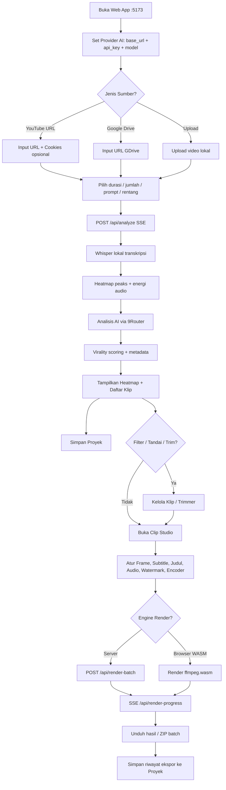
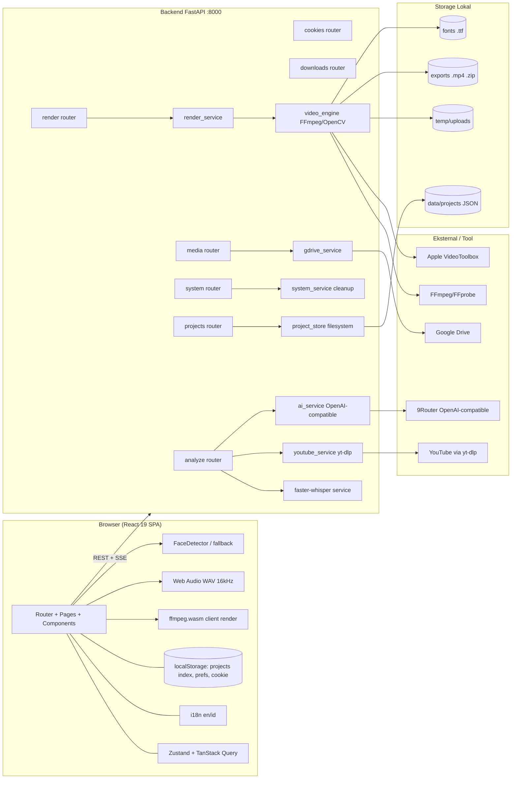

# PRD — ClipForge (Rebuild Cheat Clip PRO)

> **Nama kerja:** `ClipForge` **[Perlu Konfirmasi]** — nama final dapat diganti.
> **Jenis dokumen:** Product Requirements Document (versi *decided*) untuk proyek **baru dari nol**.
> **Basis analisis:** hasil reverse-engineering proyek referensi `cheat-clip-pro` (dokumen `cheat-clip-pro/PRD.md`) — **konsep & environment** diambil, implementasi dirancang ulang.
> **Tanggal:** 17 Oktober 2026
> **Tujuan:** acuan pengembangan langsung (blueprint) yang sudah mengunci keputusan teknis pengguna.
>
> **Aturan:** Semua keputusan yang sudah ditetapkan pengguna tercantum di **Bagian 0**. Hal yang belum pasti ditandai **[Perlu Konfirmasi]** dan tidak dikarang.

---

## 0. Keputusan Desain yang Sudah Ditetapkan (Decision Log)

| # | Keputusan | Sumber | Dampak |
|---|---|---|---|
| D1 | **Distribusi klip = unduh manual** (tanpa auto-upload ke YouTube/TikTok/IG) | Jawaban Q1 | Tidak ada integrasi publish; fokus pada analisis + render + unduhan |
| D2 | **AI provider = custom OpenAI-compatible** milik pengguna (9Router) | Jawaban Q2 | Ganti Google Gemini → **OpenAI Python SDK** dengan `base_url` + `api_key` + `model` |
| D3 | **Persistensi filesystem + localStorage**, single-user, **plus fitur riwayat proyek** | Jawaban Q3, Q4 | Tambah layer "Project Store" berbasis file JSON; tanpa database |
| D4 | **Single-user lokal** | Jawaban Q4 | Tanpa auth pengguna umum; admin key opsional untuk endpoint destruktif |
| D5 | **Transkripsi 100% Whisper lokal** | Jawaban Q5 | Hapus Supadata/proxy/cloud; tidak bergantung layanan eksternal transkrip |
| D6 | **Target Apple Silicon (Mac M1), CPU + browser WASM** | Jawaban Q6 | Encoder Apple `h264_videotoolbox` + fallback `libx264`; tanpa CUDA/NVENC |
| D7 | **Rebuild penuh, arsitektur baru** | Jawaban Q7 | Frontend di-refactor (router + state library + CSS modular), backend distruktur ulang, TS `strict` aktif |
| D8 | **Distribusi = Docker + `npm run dev`** | Jawaban Q8 | Dockerfile multi-stage + compose; skrip dev berbasis Node |
| D9 | **i18n default English + Indonesian** | Jawaban Q10 | `en` default, `id` tersedia, arsitektur terjemahan ter-type-check |
| D10 | **Backend Whisper = `faster-whisper` (CTranslate2, CPU)** | Klarifikasi | Ringan & cepat di CPU Apple Silicon |
| D11 | **Lokasi = folder proyek baru** | Klarifikasi | Terpisah dari `cheat-clip-pro` |
| D12 | **Mulai dengan semua default** (dapat diganti nanti) | Permintaan | Nama `ClipForge`, lisensi **MIT**, CSS **Tailwind**, Whisper `base`/`int8`/`cpu`, base URL AI placeholder |
| D13 | **Kode harus provider-agnostic** (bisa dibangun di provider AI/lingkungan lain) | Permintaan | Tidak ada vendor lock-in; konfigurasi via env + UI Settings |

### 0.0 Default yang Dikunci (D12)
| Parameter | Nilai default |
|---|---|
| Nama produk | **ClipForge** |
| Lisensi | **MIT** |
| Styling | **Tailwind CSS** (v4, plugin Vite) |
| Routing | **react-router-dom** |
| State | **Zustand** (UI) + **TanStack Query** (server) |
| i18n | **react-i18next** — `en` (default) + `id` |
| AI provider | **OpenAI-compatible** — `AI_BASE_URL` (placeholder `http://localhost:20128/v1`) + `AI_API_KEY` + `AI_MODEL` |
| Whisper | **faster-whisper** — model `base`, `device=cpu`, `compute_type=int8` |
| Encoder | `auto` → **`h264_videotoolbox`** (M1), fallback **`libx264`** |
| Bahasa default | **English** (`en`) |

### 0.1 Perbedaan Kunci vs Proyek Referensi
| Aspek | `cheat-clip-pro` (asal) | `ClipForge` (baru) |
|---|---|---|
| Provider AI | Google Gemini (`google-genai`) langsung | **OpenAI-compatible custom** (9Router) via `openai` SDK |
| Transkripsi | Supadata → youtube-transcript-api → yt-dlp → Whisper | **faster-whisper lokal saja** |
| Proxy | Webshare/Supadata proxy rotasi | **Tidak ada** (Whisper lokal, tanpa proxy) |
| Encoder | NVENC/AMF/QSV/CPU | **VideoToolbox (M1)** / CPU `libx264` / Browser WASM |
| Frontend | Monolit `App.tsx` 5108 baris, tanpa router, CSS tunggal | **Router + state library + CSS modular + TS strict** |
| Riwayat proyek | Tidak ada (cache `localStorage`) | **Fitur riwayat proyek** (file JSON + index localStorage) |
| Riwayat render | In-memory | File JSON tersimpan (audit + lanjutkan) |

---

## 1. Ringkasan Produk

### 1.1 Nama & Tagline
- **Nama:** ClipForge **[Perlu Konfirmasi]**.
- **Tagline (usulan):** *"From long videos to scroll-stopping shorts — locally, with your own AI."*

### 1.2 Tujuan
Aplikasi **self-hosted lokal** yang mengubah video panjang (YouTube / Google Drive / upload) menjadi banyak klip vertikal siap-unggah, dengan AI memilih momen viral, lalu rendering lokal (server FFmpeg atau browser WASM), **tanpa ketergantungan cloud selain provider AI pilihan pengguna**.

### 1.3 Masalah yang Diselesaikan
- Menemukan momen viral di video panjang secara sistematis.
- Editing berulang (crop vertikal, face-centering, subtitle karaoke, branding) yang memakan waktu.
- **Privasi & biaya**: transkripsi dijalankan sepenuhnya lokal (Whisper), dan AI memakai provider sendiri (gratis/kontrol penuh).
- Tidak ada riwayat pada proyek lama → **ClipForge menyimpan riwayat proyek**.

### 1.4 Target Pengguna
- Content creator/clipper individual dengan **Mac Apple Silicon (M1)**.
- Pengguna teknis yang mampu menjalankan Node.js + Python + FFmpeg, atau Docker.
- **Single-user**, pemakaian pribadi.

### 1.5 Distribusi & Lingkungan Target
- **Dev:** `npm run dev` (frontend Vite + backend FastAPI via skrip Node).
- **Produksi lokal:** Docker (`docker-compose up`).
- Lingkungan unggulan: **macOS (Apple Silicon M1)**, CPU; render berat opsional di browser (WASM).

---

## 2. Fitur & Fungsionalitas

Prioritas: **M** = Must-have, **S** = Should-have, **N** = Nice-to-have.

### 2.1 Modul: Input Sumber Video
| ID | Fitur | Prioritas |
|---|---|---|
| F-01 | Analisis dari **URL YouTube** | M |
| F-02 | Analisis dari **URL Google Drive** (unduh publik) | S |
| F-03 | **Upload video lokal** (chunked) | S |
| F-04 | **Opsi rentang analisis** (seluruh video / rentang mulai–selesai) | S |
| F-05 | Sumber transkrip manual (SRT/TXT) sebagai alternatif Whisper | N |

**User story AC (F-01)**
- AC1: Input URL YouTube → `POST /api/analyze` mengembalikan `video_id`, `title`, `duration`, `heatmap`, `summary`, `clips` via SSE.
- AC2: Bila video tidak punya caption, sistem tetap menghasilkan transkrip via **faster-whisper lokal**.
- AC3: **Tanpa** ketergantungan layanan transkrip eksternal (tidak ada Supadata/proxy).

### 2.2 Modul: Transkripsi Lokal (Whisper)
| ID | Fitur | Prioritas |
|---|---|---|
| F-06 | Transkripsi **faster-whisper** (CTranslate2) di CPU | M |
| F-07 | Pilihan ukuran model (`tiny`/`base`/`small`/`medium`) & `compute_type` | S |
| F-08 | Transkripsi **word-level** untuk subtitle karaoke | M |
| F-09 | Deteksi bahasa otomatis (default Indonesia/Inggris) | S |
| F-10 | Cache transkrip per video (file JSON) agar tidak mengulang | S |

**AC (F-06/F-08)**
- AC1: Model di-load lazy dan dapat di-unload untuk menghemat RAM.
- AC2: Output word-level dipakai membangun chunk subtitle 1–3 kata (maks 22 karakter).
- AC3: Tidak ada panggilan jaringan untuk transkripsi.

### 2.3 Modul: Analisis AI (Highlight Detection) — Provider Custom
| ID | Fitur | Prioritas |
|---|---|---|
| F-11 | Analisis via **OpenAI-compatible endpoint** (9Router): `base_url` + `api_key` + `model` | M |
| F-12 | **Skor viralitas 1–100** + `hook_time` per klip | M |
| F-13 | Judul bahasa asli (zero-translation) tanpa kata ganti orang pertama | S |
| F-14 | Saran `title_suggestion`, `caption_suggestion`, `hashtag_suggestion` | S |
| F-15 | **Prompt kustom** untuk memfokuskan pencarian | S |
| F-16 | Target durasi (15s/30s/60s/auto) & jumlah klip (auto/angka) | M |
| F-17 | **Daftar model** dari provider (`GET /v1/models`) + pemilih model | S |
| F-18 | Mode **mock** (tanpa provider) untuk demo/offline | N |
| F-19 | **Fallback model** & parsing JSON toleran bila output tidak rapi | S |

**AC (F-11/F-19)**
- AC1: Klien AI dibuat dari `AI_BASE_URL` + `AI_API_KEY`; model dipilih dari `AI_MODEL`.
- AC2: Upaya **structured output** memakai `response_format` JSON schema bila didukung; jika tidak, fallback `json_object` + validasi Pydantic + `parse_lenient_json`.
- AC3: Kegagalan satu model → coba model fallback berikutnya; kesalahan dilaporkan ramah via SSE.
- **[Perlu Konfirmasi]** Apakah 9Router mendukung `response_format: json_schema`; jika tidak, gunakan jalur `json_object`.

### 2.4 Modul: Heatmap & Timeline
| ID | Fitur | Prioritas |
|---|---|---|
| F-20 | Heatmap retensi audiens YouTube (via yt-dlp) bila tersedia | S |
| F-21 | Heatmap **energi audio** lokal (fallback, ±100 titik RMS 0–1) | M |
| F-22 | Timeline SVG interaktif (tooltip, playhead, zona klip aktif) | M |

### 2.5 Modul: Manajemen Klip
| ID | Fitur | Prioritas |
|---|---|---|
| F-23 | Daftar klip + skor viralitas | M |
| F-24 | Filter (semua/tinggi/sedang-rendah/ditandai) & sortir (viralitas/kronologis/durasi/ditandai) | S |
| F-25 | Tandai klip | S |
| F-26 | Copy judul/caption/timestamp | N |
| F-27 | Ekspor JSON & SRT | N |
| F-28 | Pratinjau klip | S |
| F-29 | Clip Trimmer (±2 menit) + unduh klip mentah | S |

### 2.6 Modul: Clip Studio (Render Settings)
| ID | Fitur | Prioritas |
|---|---|---|
| F-30 | Aspect ratio: `9:16`, `1:1`, `4:3`, `16:9` (+ landscape) | M |
| F-31 | Background: `black` / `blurred` | S |
| F-32 | **Face tracking** otomatis (framing horizontal) | M |
| F-33 | Preset streamer (`none` / `split_top_cam` / `pip_corner`) + posisi facecam | S |
| F-34 | **Subtitle karaoke** dengan beberapa gaya (`viral_pop`, `beast_punch`, `cyber_violet`, `fire_red`, `electric_cyan`, `golden_aura`, `clean_minimal`, `none`) | M |
| F-35 | Font caption/judul (Outfit, Montserrat, Inter, Impact, Bebas Neue, Anton, Poppins, Arial Black, custom) | S |
| F-36 | Judul/hook: prefix, suffix, posisi, durasi, ukuran, text case | M |
| F-37 | Prefix/suffix nama file output | N |
| F-38 | **BGM** (upload, volume, offset) | S |
| F-39 | **Hook SFX** | S |
| F-40 | **Voice boost** audio asli (0–200%) | S |
| F-41 | **Watermark** gambar/teks (ukuran, opacity, posisi) | S |
| F-42 | **Font kustom** (.ttf/.otf) + font emoji warna | N |
| F-43 | **Encoder**: `auto` / `videotoolbox` (M1) / `cpu` (libx264) / `browser_wasm` | M |
| F-44 | Render mode: `separate` / `merged` (kompilasi) | S |

**AC (F-34/HW & F-43)**
- AC1: Subtitle dibangun sebagai `.ass` (libass); bila FFmpeg tanpa filter `subtitles`, tampilkan pesan instalasi (`brew install ffmpeg`).
- AC2: Deteksi `h264_videotoolbox` (Apple) → fallback `libx264 -preset veryfast -crf 22`.
- AC3: Sesuai D6, tidak ada opsi NVENC/AMF/QSV.

### 2.7 Modul: Rendering
| ID | Fitur | Prioritas |
|---|---|---|
| F-45 | Render server FFmpeg (`POST /api/render-batch`) | M |
| F-46 | Render **client-side `ffmpeg.wasm`** (upload lokal, 0% CPU server) | M |
| F-47 | Progres SSE per klip (`pending→downloading→transcribing→tracking→rendering→completed/error`) | M |
| F-48 | Retry klip gagal | S |
| F-49 | Unduh per file & **ZIP batch** | M |

### 2.8 Modul: Riwayat Proyek (BARU — D3)
| ID | Fitur | Prioritas |
|---|---|---|
| F-50 | **Simpan proyek** (sumber, metadata video, transkrip, heatmap, daftar klip, preset render) | M |
| F-51 | **Daftar & telusuri proyek** (index) | M |
| F-52 | **Buka kembali** proyek → memuat klip & pengaturan tanpa analisis ulang | M |
| F-53 | **Ganti nama / duplikat / hapus** proyek | S |
| F-54 | Riwayat **render & ekspor** per proyek (file, waktu, ukuran, status) | S |
| F-55 | **Impor/Ekspor proyek** (JSON) untuk backup | N |
| F-56 | Thumbnail proyek otomatis | N |

**Data model (Project)**
```jsonc
{
  "id": "prj_20261017_ab12",
  "name": "Podcast Frima — Eps 12",
  "created_at": "2026-10-17T10:00:00Z",
  "updated_at": "2026-10-17T10:20:00Z",
  "source": { "type": "youtube|gdrive|upload", "url": "...", "video_id": "...", "local_path": "..." },
  "video": { "title": "...", "duration": 3600, "channel": "..." },
  "transcript": [ { "start": 0.0, "end": 2.3, "text": "..." } ],
  "heatmap": [ { "start_time": 0.0, "end_time": 12.0, "value": 0.42 } ],
  "summary": "...",
  "clips": [ /* ViralClip[] */ ],
  "render_preset": { /* RenderSettings */ },
  "exports": [ { "file": "clip_1.mp4", "created_at": "...", "size_bytes": 123, "status": "completed" } ],
  "ai": { "base_url": "...", "model": "..." }
}
```

**AC (F-50/F-52)**
- AC1: Proyek disimpan sebagai satu file JSON di `data/projects/<id>.json`; index ringan di `localStorage` untuk akses cepat.
- AC2: Membuka proyek memulihkan daftar klip, pengaturan render, dan riwayat ekspor.
- AC3: Tidak menggunakan database (sesuai D3).

### 2.9 Modul: Unduhan Video Mentah
| ID | Fitur | Prioritas |
|---|---|---|
| F-57 | Unduh video penuh (job background + polling status) | S |
| F-58 | Unduh potongan klip mentah | S |

### 2.10 Modul: Cookie YouTube (opsional)
| ID | Fitur | Prioritas |
|---|---|---|
| F-59 | Input cookie (paste/`cookies.txt`) → normalisasi Netscape | S |
| F-60 | Validasi & status cookie | S |
| F-61 | Cookie **disimpan di `localStorage`** (server hanya memakai file sementara) | S |
| F-62 | Peringatan cookie + opsi "Guest Mode" per sesi | N |

### 2.11 Modul: Sistem & Pemeliharaan
| ID | Fitur | Prioritas |
|---|---|---|
| F-63 | Info storage temp + Clear Temp (proteksi admin opsional) | S |
| F-64 | Auto-cleanup temp (TTL + kuota + interval) | M |
| F-65 | Deteksi encoder & daftar model AI | M |
| F-66 | Health check backend | M |
| F-67 | Update & restart aplikasi dari UI | N |

### 2.12 Modul: Internasionalisasi
| ID | Fitur | Prioritas |
|---|---|---|
| F-68 | Bahasa **English (default)** & **Indonesian** | M |
| F-69 | Deteksi dari `navigator.language`, persist di `localStorage`, sinkron antar-tab | N |
| F-70 | Kelengkapan terjemahan dijaga tipe (`Translations = typeof en`) | N |

---

## 3. Alur Pengguna (User Flow)

### 3.1 Narasi
1. Buka web app (`http://localhost:5173`); backend `:8000`; Vite proxy `/api`.
2. Konfigurasi provider AI (base URL + API key dari 9Router + pilih model) — tersimpan di `localStorage`.
3. Pilih sumber: **YouTube / Google Drive / Upload**.
4. Atur target durasi, jumlah klip, prompt kustom, rentang analisis; (opsional) cookie.
5. Klik **Analyze** → progres SSE: transkripsi lokal (Whisper) → heatmap → analisis AI → metadata.
6. Lihat hasil: heatmap, ringkasan, daftar klip + skor.
7. Kelola klip (filter/sortir/tandai/pratinjau/trim/copy/ekspor).
8. **Simpan sebagai proyek** (opsional namun disarankan).
9. Buka **Clip Studio**: frame/crop, subtitle, judul, watermark, BGM, SFX, voice boost, encoder, mode render; centang klip.
10. **Batch Render** → pilih engine (server VideoToolbox/CPU, atau browser WASM) → pantau progres.
11. Unduh hasil per klip atau **ZIP**.
12. Riwayat proyek menyimpan status & tautan ekspor untuk sesi berikutnya.

### 3.2 Diagram Mermaid — User Flow


---

## 4. Arsitektur Sistem

### 4.1 Komponen
- **Frontend (React 19 + Vite + TS strict)** — UI, routing, state, i18n, editor studio, timeline heatmap, render WASM, ekstraksi audio (Web Audio), deteksi wajah klien.
- **Backend (FastAPI, Python 3.11+)** — API REST + SSE, orkestrasi (unduh → Whisper lokal → AI → render), project store, pembersihan otomatis.
- **Layanan eksternal (minimal):**
  - **Provider AI OpenAI-compatible** (9Router) — analisis pemilihan klip.
  - **YouTube** (yt-dlp) — sumber video/heatmap/thumbnail.
  - **Google Drive** — unduh publik.
  - *Tidak ada* Supadata/proxy/cloud transkrip (D5).
- **Tool native:** FFmpeg (dengan libass) + FFprobe + yt-dlp + Git (opsional).

### 4.2 Diagram Arsitektur — Mermaid


### 4.3 Alur Data
1. **Analisis:** `POST /api/analyze` → unduh audio (yt-dlp) → **Whisper lokal** (word-level) → heatmap (yt-dlp/energi audio) → `ai_service` (OpenAI-compatible) → hasil SSE ke Frontend → opsi simpan ke **project store**.
2. **Render server:** `POST /api/render-batch` → `render_service` → `video_engine` (unduh segmen → potong → face track → `.ass` → filtergraph → VideoToolbox/CPU) → `exports/` → progres SSE → unduh.
3. **Render klien:** `ffmpeg.wasm` di browser (khusus upload/lokal).
4. **Proyek:** `POST/PUT /api/projects` → JSON di `data/projects/<id>.json`; index di `localStorage`.
5. **Cookie:** `localStorage` → kirim per-request → file sementara backend → dihapus.

---

## 5. Tech Stack

### 5.1 Frontend (Rebuild — D7)
| Teknologi | Usulan versi | Alasan |
|---|---|---|
| React | 19.x | Library UI |
| Vite | 8.x | Dev/build cepat; proxy `/api` → `:8000` |
| TypeScript | 5.9+/6.x, **`strict: true`** | Menutup kelemahan proyek asal (strict tidak aktif) |
| react-router-dom | 7.x | **Routing** (asal tanpa router) |
| Zustand | 5.x | State UI global ringan |
| TanStack Query | 5.x | State server (cache, retry, invalidasi) |
| Tailwind CSS **atau** CSS Modules | 4.x / — | **CSS modular** (asal: satu file 4930 baris) |
| `@ffmpeg/ffmpeg` + `@ffmpeg/util` | 0.12.x | Render client-side WASM |
| i18n (react-i18next atau konteks ringan) | — | en (default) + id |

**[Perlu Konfirmasi]** pilihan Tailwind vs CSS Modules.

### 5.2 Backend
| Teknologi | Versi usulan | Alasan |
|---|---|---|
| FastAPI | ≥0.11x | API + SSE + background task |
| Uvicorn[standard] | ≥0.30 | ASGI server |
| Pydantic | v2 | Skema & validasi |
| python-multipart | ≥0.0.9 | Upload |
| python-dotenv | ≥1.0 | `.env` |
| **openai** (SDK) | ≥1.x | Klien **OpenAI-compatible** ke 9Router (D2) |
| yt-dlp | versi stabil terpin | Unduh & metadata YouTube |
| **faster-whisper** | ≥1.0 | Transkripsi lokal CTranslate2 (D10) |
| numpy | ≥1.24 | Heatmap energi audio (RMS) |
| opencv-python | ≥4.8 | Deteksi wajah (YuNet ONNX + Haar + saliency) |
| Pillow | ≥10 | Overlay judul/watermark (emoji, anti-alias) |
| requests | ≥2.31 | Unduh Google Drive |

**Dihapus dari proyek asal:** `google-genai`, `openai-whisper` (PyTorch), `torch`, `youtube-transcript-api`, Supadata/Webshare/proxy.

**Tool native:** FFmpeg (dengan **libass**), FFprobe, yt-dlp, Git.

### 5.3 Runtime
- Node.js ≥18 (dev), Python ≥3.11 (Docker `python:3.11-slim`).
- Docker builder `node:20-alpine`.
- Encoder: **Apple VideoToolbox** (`h264_videotoolbox`) utama di M1; fallback `libx264`.

---

## 6. Desain Backend

### 6.1 Endpoint API (usulan, prefix `/api`)
| Modul | Method | Path | Keterangan |
|---|---|---|---|
| Analyze | POST | `/api/analyze` | **SSE**: transkripsi Whisper → heatmap → AI → hasil |
| Analyze | GET | `/api/health` | Health check |
| AI | GET | `/api/models` | Proxy `GET /v1/models` provider (9Router) |
| Projects | GET | `/api/projects` | Daftar proyek |
| Projects | POST | `/api/projects` | Buat/simpan proyek |
| Projects | GET | `/api/projects/{id}` | Detail proyek |
| Projects | PUT | `/api/projects/{id}` | Perbarui proyek |
| Projects | DELETE | `/api/projects/{id}` | Hapus proyek |
| Projects | POST | `/api/projects/{id}/duplicate` | Duplikat |
| Projects | GET | `/api/projects/{id}/export` | Ekspor JSON |
| Projects | POST | `/api/projects/import` | Impor JSON |
| Render | POST | `/api/render-batch` | Mulai batch |
| Render | POST | `/api/render-batch/{batch_id}/retry` | Retry klip gagal |
| Render | GET | `/api/render-progress/{batch_id}` | **SSE** progres |
| Render | GET | `/api/download-rendered/{file_name}` | Unduh file |
| Render | GET | `/api/download-batch-zip/{batch_id}` | Unduh ZIP |
| Render | GET | `/api/hardware-accel` | Deteksi encoder (VideoToolbox/CPU) |
| Media | POST | `/api/upload-video` | Upload video (chunked) |
| Media | GET | `/api/video/{file_name}` | Stream (Range) |
| Media | POST | `/api/upload-bgm` / `/api/upload-sfx` / `/api/upload-watermark` / `/api/upload-font` | Aset |
| Media | GET | `/api/clip-frame` / `/api/detect-face` / `/api/fonts` | Utilitas |
| Cookies | POST/GET/DELETE | `/api/cookies` | Validasi/status/hapus |
| Downloads | POST | `/api/download-raw-video` / `/api/download-raw-clip` | Job unduh mentah |
| Downloads | GET | `/api/download-raw-status/{job_id}` / `/api/download-raw-clip-status/{job_id}` | Status |
| System | GET | `/api/temp-storage-info` | Info storage |
| System | POST | `/api/clear-temp` (admin) | Bersihkan temp |
| System | POST | `/api/cleanup-expired-temp` (admin) | Bersihkan kadaluarsa |
| System | GET | `/api/system/version` | Versi |
| System | GET | `/api/system/check-update` | Cek update |
| System | POST | `/api/system/update` (admin) | Update |
| System | POST | `/api/system/restart` (admin) | Restart |

> **Otorisasi admin** (mengikuti pola referensi): jika env `ADMIN_API_KEY` atau `CHEAT_CLIP_API_KEY` diisi, endpoint destruktif butuh header `X-API-Key` atau `Authorization: Bearer <key>`. Jika kosong → akses terbuka (default desktop lokal).

### 6.2 Skema Data (Pydantic)
- **`AnalyzeRequest`**: `url`, `duration` ("30s"|"15s"|"60s"|"auto"), `model`, `base_url?`, `custom_prompt?`, `range_start?`, `range_end?`, `subtitles?`, `subtitles_filename?`, `target_clip_count?`, `cookies?`, `language?` ("id"|"en").
- **`ViralClip`**: `title`, `start_time`, `end_time`, `hook_time`, `virality_score` (1–100), `key_quotes[]`, `transcript`, `title_suggestion`, `caption_suggestion`, `hashtag_suggestion`.
- **`VideoAnalysis`**: `summary`, `clips[]` (target structured output AI).
- **`HeatmapPoint`**: `start_time`, `end_time`, `value`.
- **`TranscriptLine`**: `start`, `end`, `text`, `engagement?`.
- **`AnalyzeResponse`**: `video_id`, `title`, `channel?`, `duration`, `heatmap[]`, `summary`, `clips[]`, `transcript?`, `model?`, `video_url?`, `source_type?`.
- **`RenderSettingsModel`**: mirror `RenderSettings` frontend (aspect ratio, background, face tracking, streamer preset, judul, subtitle, BGM, SFX, voice boost, watermark, `encoder` (`auto`|`videotoolbox`|`cpu`|`browser_wasm`), render_mode, compilation_title).
- **`Project`**: lihat Bagian 2.8 (D3).

### 6.3 Pemrosesan Background
- **Auto-cleanup worker**: jeda awal ~10–15s; interval default **1800s**; TTL **3600s**; kuota **5 GB** (FIFO purge ke 80%).
- **Batch render** sebagai background task + SSE.
- **Pipeline video**: unduh segmen → cek audio → **Whisper lokal (word-level)** → face track → `.ass` → overlay Pillow → filtergraph → encode **VideoToolbox/CPU** → `.mp4` (`faststart`, `shortest`).
- **Ekstraksi frame preview**: fallback lokal → klip → slice yt-dlp → cache → thumbnail YouTube.

---

## 7. Desain Frontend (Rebuild)

### 7.1 Routing (baru)
```
/                     → Halaman Analyze (input + hasil)
/studio/:projectId    → Clip Studio
/projects             → Daftar proyek (riwayat)
/projects/:id         → Detail proyek
/settings             → Provider AI, encoder, bahasa, cookies
```
Modal (bukan route): Trimmer, Cookies, Batch Progress, Update, Cookie Warning.

### 7.2 Struktur Komponen (usulan)
```
src/
├── app/                 # router, providers (QueryClient, i18n, theme)
├── pages/               # Analyze, Studio, Projects, ProjectDetail, Settings
├── features/
│   ├── analyze/         # form, progress, results, heatmap
│   ├── studio/          # control panels, preview, render bar
│   ├── projects/        # daftar, kartu, aksi
│   ├── clips/           # list, filter, mark, card
│   └── system/          # update, storage, encoder
├── components/          # UI primitif (Button, Modal, Slider, Pill...)
├── lib/                 # apiClient, sse, ffmpegWasm, audio, faceDetect, format
├── store/               # zustand stores
├── i18n/                # en.ts, id.ts, provider
└── types/               # tipe bersama
```

### 7.3 State Management & Data
- **Zustand** untuk state UI (mode sumber, seleksi klip, pengaturan studio).
- **TanStack Query** untuk data server (proyek, model, hardware-accel, progres) dengan retry & cache.
- **SSE** untuk `/api/analyze` dan `/api/render-progress`.
- `apiClient` dengan retry 502/503/504 (backoff 1.5^n).

### 7.4 Panduan UI/UX
- Tema gelap (violet/rose/emerald), font Outfit/Inter; glassmorphism; desktop-first.
- **Perbaikan:** pecah CSS jadi modul; dukung lebih banyak breakpoint (tidak hanya `min-width: 1200px`); hilangkan teks hardcoded non-i18n.

---

## 8. Kebutuhan Non-Fungsional

### 8.1 Performa
- Whisper `base`/`small` dengan `compute_type=int8` di CPU M1; lazy load + unload.
- Encoder `h264_videotoolbox` (M1) untuk render cepat; fallback `libx264`.
- Timeout render adaptif; Range streaming untuk pratinjau; auto-cleanup disk.
- **Risiko:** Whisper CPU bisa lambat untuk video panjang → cache transkrip (F-10) & opsi model kecil.

### 8.2 Keamanan
- Header keamanan: `nosniff`, `SAMEORIGIN`, `X-XSS-Protection`.
- CORS dibatasi origin lokal.
- Proteksi path (`_is_safe_path`) & perlindungan file sistem.
- Cookie stateless (file sementara dibersihkan).
- Admin key opsional untuk endpoint destruktif.
- **[Perlu Konfirmasi]** Tidak ada auth pengguna (single-user lokal).

### 8.3 Skalabilitas
- **Single-node, single-user** (D4). State render in-memory + filesystem.
- Docker limit memori (mis. 3200M); cocok VPS/Apple Silicon kecil.
- **[Perlu Konfirmasi]** Tanpa antrean terdistribusi.

### 8.4 Error Handling
- Retry API 502/503/504; validasi MP4 (atom `moov`); fallback encoder; fallback model AI; `parse_lenient_json`; status per klip (`error_message`).

### 8.5 Logging
- Logger bernama aplikasi; penyamaran kredensial; **[Perlu Konfirmasi]** rotasi/observability.

---

## 9. Deployment & DevOps

### 9.1 Docker
- **Multi-stage:** `node:20-alpine` (build frontend) → `python:3.11-slim` (runtime).
- Sistem: `ffmpeg` (dengan libass), `libgl1`, `libglib2.0-0`, `curl`.
- **Tanpa Torch** (Whisper = faster-whisper/CTranslate2) → image lebih ramping.
- `EXPOSE 8000`; CMD `uvicorn backend.main:app --host 0.0.0.0 --port 8000`.
- Healthcheck: **selaraskan endpoint** (mis. `GET /api/health`) — jangan ulangi bug `system-stats` proyek asal.
- **compose:** port `8000:8000`, `restart: unless-stopped`, volume `data/`, `temp/`, `exports/`, `fonts/`; limit memori.

### 9.2 Script Start/Update
- `npm run dev` = `concurrently` frontend + backend.
- `scripts/start-backend.js`: cari Python (venv → `PYTHON_PATH` → sistem), uji import, auto `pip install` bila perlu, jalankan uvicorn (`--reload`), forward `SIGINT`/`SIGTERM`.
- Skrip update: `git pull` (deteksi branch otomatis) → `npm install` → `pip install -r requirements.txt`.

### 9.3 Environment Variables (usulan)
| Variabel | Fungsi | Default |
|---|---|---|
| `AI_BASE_URL` | Base URL OpenAI-compatible (9Router), mis. `http://localhost:XXXX/v1` | **[Perlu Konfirmasi]** |
| `AI_API_KEY` | API key provider | kosong |
| `AI_MODEL` | Model default untuk analisis | **[Perlu Konfirmasi]** |
| `AI_FALLBACK_MODELS` | Daftar model fallback (comma) | kosong |
| `WHISPER_MODEL` | Ukuran model faster-whisper | `base` |
| `WHISPER_DEVICE` | `cpu` | `cpu` |
| `WHISPER_COMPUTE_TYPE` | `int8` | `int8` |
| `FFMPEG_ENCODER` | `auto`/`videotoolbox`/`cpu` | `auto` |
| `HOST` / `PORT` | Alamat/port server | `127.0.0.1` / `8000` |
| `ALLOWED_ORIGINS` | CORS | origin lokal |
| `ADMIN_API_KEY` / `CHEAT_CLIP_API_KEY` | Kunci admin endpoint destruktif (opsional) | kosong |
| `CLEANUP_INTERVAL_SECONDS` | Interval auto-cleanup | `1800` |
| `TEMP_MAX_AGE_SECONDS` | TTL temp | `3600` |
| `TEMP_STORAGE_QUOTA_GB` | Kuota temp | `5.0` |
| `DATA_DIR` | Lokasi penyimpanan proyek | `./data` |

> Catatan: **tidak ada** `SUPADATA_API_KEYS`, `WEBSHARE_*`, `PROXY_URL`, `GEMINI_API_KEY` (sesuai D2/D5).

---

## 10. Struktur Folder (Usulan)

```
clipforge/
├── package.json                 # Skrip frontend + orkestrasi dev
├── index.html
├── vite.config.ts               # Proxy /api → :8000
├── tsconfig*.json               # strict: true
├── eslint.config.js
├── Dockerfile                   # Multi-stage (node → python)
├── docker-compose.yml
├── .env.example                 # AI_BASE_URL, AI_API_KEY, AI_MODEL, WHISPER_*
├── scripts/
│   └── start-backend.js         # Bootstrap Python/FastAPI
├── src/                         # ===== FRONTEND =====
│   ├── main.tsx
│   ├── app/                     # router + providers
│   ├── pages/                   # Analyze, Studio, Projects, Settings
│   ├── features/                # analyze, studio, projects, clips, system
│   ├── components/              # UI primitif
│   ├── lib/                     # apiClient, sse, ffmpegWasm, audio, faceDetect
│   ├── store/                   # zustand
│   ├── i18n/                    # en.ts, id.ts
│   └── types/
├── backend/                     # ===== BACKEND =====
│   ├── main.py                  # FastAPI, CORS, worker, mount SPA
│   ├── config.py                # Path, dotenv, logger
│   ├── video_engine.py          # FFmpeg/OpenCV/subtitle/overlay
│   ├── routers/                 # analyze, render, media, cookies, downloads, system, projects
│   ├── schemas/                 # analyze, render, downloads, project
│   ├── services/                # ai_service (OpenAI-compatible), youtube_service,
│   │                            # gdrive_service, render_service, whisper_service,
│   │                            # system_service, project_store
│   ├── utils/                   # heatmap, sse, text
│   ├── fonts/                   # Font + emoji (seguiemj.ttf)
│   └── cascades/                # face_detection_yunet.onnx + Haar XML
├── data/                        # Riwayat proyek (JSON) — persisted
│   └── projects/
├── temp/                        # File sementara (auto-cleanup)
└── exports/                     # Hasil render (.mp4) & ZIP
```

---

## 11. Roadmap Implementasi

### Fase 0 — Fondasi & Scaffold (Minggu 1)
- Monorepo: FastAPI + React/Vite (TS strict), router, Zustand, TanStack Query, i18n (en/id), Tailwind/CSS Modules.
- `GET /api/health`, CORS, `.env.example`, `npm run dev`.
- **Selesai:** UI ber-router memanggil backend dan menampilkan status + ganti bahasa.

### Fase 1 — MVP Analisis + Whisper Lokal (Minggu 2–3)
- `whisper_service` (faster-whisper, word-level, cache).
- `POST /api/analyze` (SSE): yt-dlp audio → Whisper → heatmap (audio + retensi) → **AI via 9Router**.
- `GET /api/models` (proxy `/v1/models`); halaman Settings provider AI.
- UI Analyze: input, progres, daftar klip + skor, timeline heatmap.
- **Selesai:** URL YouTube → daftar klip viral (transkripsi lokal penuh).

### Fase 2 — Riwayat Proyek (Minggu 4)
- `project_store` + `routers/projects.py` (CRUD, duplikat, impor/ekspor).
- Halaman Projects + index `localStorage`; simpan/buka proyek.
- **Selesai:** proyek tersimpan & dapat dibuka kembali tanpa analisis ulang.

### Fase 3 — Render Dasar + VideoToolbox (Minggu 5)
- `video_engine`: segmentasi, potong, `.ass` dasar, encode `h264_videotoolbox` (fallback `libx264`).
- `POST /api/render-batch` + SSE + unduh per file.
- **Selesai:** 1 klip → MP4 9:16 bersubtitle, cepat di M1.

### Fase 4 — Clip Studio Lengkap (Minggu 6–7)
- Semua opsi `RenderSettings`: background, judul/hook, font, watermark, BGM, SFX, voice boost, text case, posisi.
- Trimmer, filter/sortir/mark, ekspor JSON/SRT.
- **Selesai:** kustomisasi tampilan klip end-to-end.

### Fase 5 — Face Tracking & Streaming Preset (Minggu 8)
- Deteksi wajah (YuNet/Haar/saliency), framing, preset streamer.
- `GET /api/hardware-accel` (VideoToolbox/CPU) + badge status di UI.
- **Selesai:** speaker ter-frame otomatis.

### Fase 6 — Browser WASM + Batch ZIP (Minggu 9)
- Render client-side `ffmpeg.wasm` (upload/lokal), `BatchRenderProgressModal`, ZIP, retry.
- **Selesai:** batch → ZIP; fallback klien tersedia (tanpa CPU server).

### Fase 7 — Sumber Tambahan & Cookie (Minggu 10)
- Google Drive, upload chunked, subtitle manual, rentang analisis; cookie stateless + warning.
- **Selesai:** tiga jenis sumber & cookie berfungsi.

### Fase 8 — Operasional, i18n & Polish (Minggu 11)
- Auto-cleanup, storage info, update/restart, penyelesaian i18n, hapus teks hardcoded, responsif.
- **Selesai:** pemeliharaan & lokalisasi lengkap.

### Fase 9 — Distribusi (Minggu 12)
- Docker multi-stage + compose (tanpa Torch), `scripts/start-backend.js`, README, `.env.example`, `LICENSE`.
- **Selesai:** jalan via `npm run dev` dan Docker.

**Estimasi:** ±12 minggu (1 pengembang), dapat dipangkas dengan memakai ulang library inti (yt-dlp, FFmpeg, faster-whisper, OpenAI SDK).

---

## 12. Risiko, Asumsi & Pengembangan Lanjutan

### 12.1 Risiko
| Risiko | Dampak | Mitigasi |
|---|---|---|
| Whisper CPU lambat untuk video panjang di M1 | Analisis lama | Model kecil (`base`/`small`), `int8`, cache transkrip, progres jelas |
| Provider AI (9Router) tak mendukung `json_schema` | Output tak terstruktur | Fallback `json_object` + validasi Pydantic + `parse_lenient_json` |
| Endpoint/URL 9Router tak tersedia saat dev | Analisis gagal | Mode `mock`; konfigurasi base URL di UI |
| FFmpeg tanpa `libass` | Subtitle gagal | Deteksi filter + pesan instalasi |
| VideoToolbox tak tersedia/bermasalah | Render gagal | Fallback otomatis `libx264` |
| Pemblokiran bot YouTube | Unduh gagal | Cookie opsional (tanpa proxy, sesuai D5) |
| Monorepo baru belum ada uji | Regresi | Siapkan tes minimal & linting ketat |
| Lisensi belum ditetapkan | Ambigu legal | **Diselesaikan (D12): MIT** — siapkan file `LICENSE` di Fase 0 |

### 12.2 Asumsi
- Berjalan lokal single-user, tidak diekspos publik.
- FFmpeg + FFprobe + yt-dlp terpasang (kecuali di Docker).
- Pengguna punya endpoint OpenAI-compatible (9Router) + API key + model.
- **Tidak ada auto-upload** ke platform (D1).

### 12.3 Ide Lanjutan
- Riwayat proyek lanjutan (tag, pencarian, arsip), sinkronisasi antar proyek.
- Antrean render + paralelisme worker; resume render.
- Preset/brand kit tersimpan; template subtitle impor.
- Dukungan encoder lain lintas-platform (opsional NVENC/QSV untuk non-Mac).
- Tes otomatis (backend pytest, frontend Vitest/Playwright) & CI.
- Mode CLI/headless untuk otomasi.

---

## 13. Scaffolding Fase 0 — Detail Lengkap

Bab ini adalah instruksi teknis langkah demi langkah untuk membangun **kerangka proyek yang sudah berjalan namun belum memiliki fitur** (fondasi + rangka). Semua keputusan memakai **default (D12)**.

### 13.1 Prasyarat & Versi
| Tool | Versi minimum | Instalasi (macOS M1) |
|---|---|---|
| Node.js | 18+ (disarankan 20/22) | `brew install node` atau nvm |
| Python | 3.11+ | `brew install python` |
| FFmpeg | dengan `libass` | `brew install ffmpeg` |
| yt-dlp | stabil terbaru | `brew install yt-dlp` |
| Git | apa pun | `brew install git` |

> Cek cepat: `node -v && python3 -V && ffmpeg -version | head -1 && yt-dlp --version`.

### 13.2 Perintah Inisialisasi
```bash
# 1) Buat folder proyek & inisialisasi frontend
mkdir clipforge && cd clipforge
npm create vite@latest . -- --template react-ts
npm install

# 2) Dependensi frontend (D12)
npm install react-router-dom zustand @tanstack/react-query i18next react-i18next \
            @ffmpeg/ffmpeg @ffmpeg/util
npm install -D tailwindcss @tailwindcss/vite

# 3) Virtualenv backend + dependensi Python
python3 -m venv .venv && source .venv/bin/activate
pip install fastapi "uvicorn[standard]" pydantic python-multipart python-dotenv \
            openai yt-dlp faster-whisper numpy opencv-python Pillow requests
```

### 13.3 Struktur Folder & File yang Dibuat (Fase 0)
```
clipforge/
├── package.json                 # scripts: dev/dev-frontend/dev-backend/build/lint
├── index.html
├── vite.config.ts               # @tailwindcss/vite + proxy /api,/docs → :8000
├── tsconfig.json / tsconfig.app.json / tsconfig.node.json   # strict: true
├── eslint.config.js
├── .gitignore
├── .env.example                 # AI_*, WHISPER_*, HOST/PORT, dsb.
├── LICENSE                      # MIT (D12)
├── README.md
├── PRD.md                       # dokumen ini
├── PROMPT.md                    # prompt kickoff (lihat bab 14)
├── Dockerfile                   # multi-stage: node build → python runtime
├── docker-compose.yml
├── scripts/
│   └── start-backend.js         # bootstrap Python + jalankan uvicorn
├── src/                         # ===== FRONTEND =====
│   ├── main.tsx                 # mount React + providers
│   ├── index.css                # @import "tailwindcss";
│   ├── app/
│   │   ├── router.tsx           # definisi rute
│   │   └── providers.tsx        # QueryClientProvider + I18nextProvider + Router
│   ├── components/
│   │   ├── Layout.tsx           # navbar + outlet (ganti bahasa, status backend)
│   │   ├── Button.tsx
│   │   ├── Card.tsx
│   │   ├── Modal.tsx
│   │   ├── PillGroup.tsx
│   │   └── StatusBadge.tsx
│   ├── pages/
│   │   ├── AnalyzePage.tsx      # halaman "/" (placeholder + status backend)
│   │   ├── StudioPage.tsx       # "/studio" (placeholder)
│   │   ├── ProjectsPage.tsx     # "/projects" (placeholder)
│   │   └── SettingsPage.tsx     # "/settings" (konfigurasi provider AI)
│   ├── features/
│   │   └── system/
│   │       ├── useHealth.ts     # TanStack Query → GET /api/health
│   │       └── useModels.ts     # TanStack Query → GET /api/models
│   ├── lib/
│   │   ├── apiClient.ts         # fetch + retry 502/503/504
│   │   └── sse.ts               # helper EventSource/stream (placeholder)
│   ├── store/
│   │   └── uiStore.ts           # Zustand: bahasa, provider AI tersimpan
│   ├── i18n/
│   │   ├── index.ts             # init i18next (en default, id)
│   │   ├── en.ts
│   │   └── id.ts
│   └── types/
│       └── index.ts             # tipe bersama (mirip src/types.ts referensi)
├── backend/                     # ===== BACKEND =====
│   ├── main.py                  # FastAPI, CORS, security headers, routers, worker
│   ├── config.py                # paths, dotenv, logger, konstanta
│   ├── requirements.txt         # salinan dependensi Python
│   ├── routers/
│   │   ├── __init__.py
│   │   ├── system.py            # GET /api/health, /api/system/version
│   │   ├── ai.py                # GET /api/models (proxy ke provider)
│   │   └── projects.py          # placeholder CRUD (Fase 2)
│   ├── schemas/
│   │   ├── __init__.py
│   │   └── common.py            # HealthResponse, ModelItem
│   ├── services/
│   │   ├── __init__.py
│   │   ├── ai_service.py        # klien OpenAI-compatible
│   │   ├── whisper_service.py   # placeholder faster-whisper (Fase 1)
│   │   └── system_service.py    # placeholder cleanup (Fase 8)
│   ├── utils/
│   │   ├── __init__.py
│   │   └── sse.py               # formatter SSE
│   ├── fonts/                   # (kosong) font + seguiemj.ttf menyusul
│   └── cascades/                # (kosong) face_detection_yunet.onnx menyusul
├── data/
│   └── projects/                # riwayat proyek JSON (Fase 2)
├── temp/                        # file sementara (auto-cleanup)
└── exports/                     # hasil render (.mp4/.zip)
```

### 13.4 Spesifikasi File Frontend (kontrak & cuplikan)

**`vite.config.ts`**
```ts
import { defineConfig } from 'vite'
import react from '@vitejs/plugin-react'
import tailwindcss from '@tailwindcss/vite'

export default defineConfig({
  plugins: [react(), tailwindcss()],
  server: {
    proxy: {
      '/api': { target: 'http://127.0.0.1:8000', changeOrigin: true },
      '/docs': { target: 'http://127.0.0.1:8000', changeOrigin: true },
      '/openapi.json': { target: 'http://127.0.0.1:8000', changeOrigin: true },
    },
  },
})
```

**`package.json` (scripts)**
```json
{
  "scripts": {
    "dev": "concurrently -n frontend,backend -c cyan,magenta \"npm run dev-frontend\" \"npm run dev-backend\"",
    "dev-frontend": "vite",
    "dev-backend": "node scripts/start-backend.js",
    "build": "tsc -b && vite build",
    "lint": "eslint ."
  }
}
```

**`src/app/providers.tsx`**
```tsx
import { QueryClient, QueryClientProvider } from '@tanstack/react-query'
import { I18nextProvider } from 'react-i18next'
import { BrowserRouter } from 'react-router-dom'
import i18n from '../i18n'

const qc = new QueryClient({ defaultOptions: { queries: { retry: 2 } } })
export function Providers({ children }: { children: React.ReactNode }) {
  return (
    <QueryClientProvider client={qc}>
      <I18nextProvider i18n={i18n}>
        <BrowserRouter>{children}</BrowserRouter>
      </I18nextProvider>
    </QueryClientProvider>
  )
}
```

**`src/app/router.tsx`**
```tsx
import { Routes, Route } from 'react-router-dom'
import { Layout } from '../components/Layout'
import AnalyzePage from '../pages/AnalyzePage'
import StudioPage from '../pages/StudioPage'
import ProjectsPage from '../pages/ProjectsPage'
import SettingsPage from '../pages/SettingsPage'

export function AppRouter() {
  return (
    <Routes>
      <Route element={<Layout />}>
        <Route path="/" element={<AnalyzePage />} />
        <Route path="/studio" element={<StudioPage />} />
        <Route path="/projects" element={<ProjectsPage />} />
        <Route path="/settings" element={<SettingsPage />} />
      </Route>
    </Routes>
  )
}
```

**`src/lib/apiClient.ts`** (retry 502/503/504, backoff 1.5^n)
```ts
export async function apiFetch(input: string, init: RequestInit = {}, maxRetries = 4) {
  let last: Response | null = null
  for (let i = 0; i <= maxRetries; i++) {
    try {
      const res = await fetch(input, init)
      if (![502, 503, 504].includes(res.status)) return res
      last = res
    } catch (e) { if (i === maxRetries) throw e }
    await new Promise(r => setTimeout(r, 800 * Math.pow(1.5, i)))
  }
  return last!
}
```

**`src/i18n/index.ts`**
```ts
import i18n from 'i18next'
import { initReactI18next } from 'react-i18next'
import en from './en'
import id from './id'

const saved = localStorage.getItem('clipforge_lang')
const detected = navigator.language.startsWith('id') ? 'id' : 'en'

i18n.use(initReactI18next).init({
  resources: { en: { translation: en }, id: { translation: id } },
  lng: saved || detected,
  fallbackLng: 'en',
  interpolation: { escapeValue: false },
})

i18n.on('languageChanged', l => localStorage.setItem('clipforge_lang', l))
export default i18n
```
> Kunci i18n wajib sinkron antara `en.ts` dan `id.ts`; jadikan `id.ts` bertipe `typeof en`.

**`src/features/system/useHealth.ts`**
```ts
import { useQuery } from '@tanstack/react-query'
import { apiFetch } from '../../lib/apiClient'

export const useHealth = () => useQuery({
  queryKey: ['health'],
  queryFn: async () => (await apiFetch('/api/health')).json(),
  refetchInterval: 10000,
})
```

**`src/pages/SettingsPage.tsx`** — form base URL / API key / model; simpan ke `localStorage` (dan opsional ke `store/uiStore.ts`); tombol "Test koneksi" memanggil `GET /api/models?base_url=...&api_key=...`.

### 13.5 Spesifikasi File Backend (kontrak & cuplikan)

**`backend/config.py`**
```python
import os, logging
from pathlib import Path
from dotenv import load_dotenv

BASE_DIR = Path(__file__).resolve().parent
ROOT_DIR = BASE_DIR.parent
load_dotenv(ROOT_DIR / '.env')
load_dotenv(BASE_DIR / '.env')

DATA_DIR    = Path(os.getenv('DATA_DIR', ROOT_DIR / 'data'))
PROJECTS_DIR= DATA_DIR / 'projects'
TEMP_DIR    = Path(os.getenv('TEMP_DIR', ROOT_DIR / 'temp'))
EXPORTS_DIR = Path(os.getenv('EXPORTS_DIR', ROOT_DIR / 'exports'))
FONTS_DIR   = BASE_DIR / 'fonts'
for d in (PROJECTS_DIR, TEMP_DIR, EXPORTS_DIR, FONTS_DIR):
    d.mkdir(parents=True, exist_ok=True)

AI_BASE_URL = os.getenv('AI_BASE_URL', 'http://localhost:20128/v1')
AI_API_KEY  = os.getenv('AI_API_KEY', '')
AI_MODEL    = os.getenv('AI_MODEL', '')

logger = logging.getLogger('clipforge')
logging.basicConfig(level=logging.INFO)
```

**`backend/services/ai_service.py`**
```python
from openai import OpenAI
from backend import config

def get_client(base_url: str | None = None, api_key: str | None = None) -> OpenAI:
    return OpenAI(
        base_url=base_url or config.AI_BASE_URL,
        api_key=api_key or config.AI_API_KEY or 'not-needed',
    )

def list_models(base_url: str | None = None, api_key: str | None = None) -> list[dict]:
    client = get_client(base_url, api_key)
    return [{'id': m.id, 'owned_by': getattr(m, 'owned_by', '')} for m in client.models.list().data]
```

**`backend/routers/ai.py`**
```python
from fastapi import APIRouter, Query
from backend.services import ai_service

router = APIRouter(tags=['AI'])

@router.get('/api/models')
def models(base_url: str | None = Query(None), api_key: str | None = Query(None)):
    return {'models': ai_service.list_models(base_url, api_key)}
```

**`backend/routers/system.py`**
```python
from fastapi import APIRouter
from backend import config

router = APIRouter(tags=['System'])

@router.get('/api/health')
def health():
    return {'status': 'ok', 'app': 'clipforge', 'version': '0.1.0'}

@router.get('/api/system/version')
def version():
    return {'version': '0.1.0'}
```

**`backend/main.py`**
```python
import os
from fastapi import FastAPI
from fastapi.middleware.cors import CORSMiddleware
from backend.routers import system, ai, projects

app = FastAPI(title='ClipForge API', version='0.1.0')

origins = os.getenv('ALLOWED_ORIGINS', 'http://localhost:5173,http://127.0.0.1:5173').split(',')
app.add_middleware(CORSMiddleware, allow_origins=origins,
                   allow_methods=['*'], allow_headers=['*'])

@app.middleware('http')
async def security_headers(request, call_next):
    res = await call_next(request)
    res.headers['X-Content-Type-Options'] = 'nosniff'
    res.headers['X-Frame-Options'] = 'SAMEORIGIN'
    res.headers['X-XSS-Protection'] = '1; mode=block'
    return res

app.include_router(system.router)
app.include_router(ai.router)
app.include_router(projects.router)
```
> `projects.py` Fase 0 cukup berisi `router = APIRouter(tags=['Projects'])` + satu `GET /api/projects` yang mengembalikan `{"projects": []}`.

**`backend/utils/sse.py`**
```python
def sse(data: dict) -> str:
    import json
    return f"data: {json.dumps(data)}\n\n"
```

### 13.6 Environment Variables — `.env.example`
```env
# Provider AI (OpenAI-compatible / 9Router atau lainnya)
AI_BASE_URL=http://localhost:20128/v1
AI_API_KEY=
AI_MODEL=

# Whisper lokal
WHISPER_MODEL=base
WHISPER_DEVICE=cpu
WHISPER_COMPUTE_TYPE=int8

# Encoder: auto | videotoolbox | cpu | browser_wasm
FFMPEG_ENCODER=auto

# Server
HOST=127.0.0.1
PORT=8000
ALLOWED_ORIGINS=http://localhost:5173,http://127.0.0.1:5173

# Opsional: proteksi endpoint destruktif
ADMIN_API_KEY=

# Storage
DATA_DIR=./data
TEMP_MAX_AGE_SECONDS=3600
TEMP_STORAGE_QUOTA_GB=5.0
CLEANUP_INTERVAL_SECONDS=1800
```

### 13.7 DevOps

**`Dockerfile`** (multi-stage, **tanpa Torch**)
```dockerfile
# ---- Stage 1: build frontend ----
FROM node:20-alpine AS fe
WORKDIR /app
COPY package*.json ./
RUN npm ci
COPY . .
RUN npm run build

# ---- Stage 2: runtime backend ----
FROM python:3.11-slim
ENV PYTHONUNBUFFERED=1 PORT=8000 HOST=0.0.0.0
RUN apt-get update && apt-get install -y --no-install-recommends \
    ffmpeg libgl1 libglib2.0-0 curl && rm -rf /var/lib/apt/lists/*
WORKDIR /app
COPY backend/requirements.txt ./backend/requirements.txt
RUN pip install --no-cache-dir -r backend/requirements.txt
COPY backend ./backend
COPY --from=fe /app/dist ./dist
RUN mkdir -p data/projects temp exports backend/fonts
EXPOSE 8000
HEALTHCHECK --interval=30s --timeout=10s --start-period=20s --retries=3 \
  CMD curl -f http://localhost:8000/api/health || exit 1
CMD ["python", "-m", "uvicorn", "backend.main:app", "--host", "0.0.0.0", "--port", "8000"]
```

**`docker-compose.yml`**
```yaml
services:
  clipforge:
    build: { context: ., dockerfile: Dockerfile }
    container_name: clipforge
    restart: unless-stopped
    ports: ["8000:8000"]
    environment:
      - HOST=0.0.0.0
      - PORT=8000
      - AI_BASE_URL=${AI_BASE_URL:-}
      - AI_API_KEY=${AI_API_KEY:-}
      - AI_MODEL=${AI_MODEL:-}
      - WHISPER_MODEL=${WHISPER_MODEL:-base}
    volumes:
      - ./data:/app/data
      - ./temp:/app/temp
      - ./exports:/app/exports
    deploy: { resources: { limits: { memory: 3200M } } }
```

**`scripts/start-backend.js`** — cari Python (venv → `PYTHON_PATH` → sistem), set `PYTHONPATH`, uji impor, `pip install -r backend/requirements.txt` bila perlu, lalu jalankan:
```bash
python -m uvicorn backend.main:app --host 0.0.0.0 --port 8000 --reload --reload-dir backend
```
Forward `SIGINT`/`SIGTERM` ke proses anak.

### 13.8 Urutan Eksekusi (langkah demi langkah)
1. Jalankan 13.2 (inisialisasi + dependensi).
2. Buat struktur folder 13.3.
3. Tulis file konfigurasi: `vite.config.ts`, `tsconfig*.json` (**`strict: true`**), `eslint.config.js`, `.env.example`, `LICENSE` (MIT), `.gitignore`.
4. Implementasi backend minimum: `config.py`, `main.py`, `routers/{system,ai,projects}.py`, `services/ai_service.py`, `utils/sse.py`, `requirements.txt`.
5. Implementasi frontend minimum: `main.tsx`, `app/{router,providers}.tsx`, `components/{Layout,Button,Card,Modal,PillGroup,StatusBadge}.tsx`, `pages/{Analyze,Studio,Projects,Settings}Page.tsx`, `lib/apiClient.ts`, `features/system/{useHealth,useModels}.ts`, `store/uiStore.ts`, `i18n/{index,en,id}.ts`, `types/index.ts`.
6. Tambah skrip `package.json` + `scripts/start-backend.js`.
7. Buat `Dockerfile`, `docker-compose.yml`.
8. Verifikasi (13.9).
9. Commit awal: `git init && git add -A && git commit -m "chore: scaffold Fase 0"`.

### 13.9 Perintah Verifikasi
```bash
# Backend saja
source .venv/bin/activate
python -m uvicorn backend.main:app --port 8000 &
curl -s http://localhost:8000/api/health      # {"status":"ok",...}
curl -s "http://localhost:8000/api/models"     # daftar model dari provider

# Full dev (frontend + backend)
npm run dev                                     # buka http://localhost:5173

# Docker
docker compose up --build                       # buka http://localhost:8000
```

### 13.10 Definition of Done (Fase 0)
- [ ] `npm run dev` menyalakan frontend (`:5173`) dan backend (`:8000`) bersamaan.
- [ ] Routing `/`, `/studio`, `/projects`, `/settings` berfungsi.
- [ ] Tombol ganti bahasa EN ⇄ ID bekerja dan persisten setelah reload.
- [ ] Halaman Analyze menampilkan **status backend** (hijau) dari `GET /api/health`.
- [ ] Halaman Settings dapat menyimpan `base_url`/`api_key`/`model` dan **mengetes** `GET /api/models` ke provider 9Router.
- [ ] `docker compose up --build` berhasil & healthcheck hijau (memakai `/api/health`).
- [ ] TypeScript `strict` tanpa error; `npm run lint` bersih.
- [ ] Struktur folder & `.env.example` sesuai bab ini; `LICENSE` MIT ada.

> **Catatan:** Fase 0 **tidak** memuat analisis video, Whisper nyata, render, maupun riwayat proyek — semua itu Fase 1+.

---

## Ringkasan Singkat

**ClipForge** adalah pembangunan ulang konsep *auto-clipper* dari `cheat-clip-pro`, disesuaikan dengan kebutuhan pribadi pengguna: **AI via provider OpenAI-compatible (9Router)**, **transkripsi 100% lokal dengan faster-whisper**, **target Mac M1 (VideoToolbox/CPU + browser WASM)**, **fondasi frontend/backend baru yang lebih bersih**, dan **fitur riwayat proyek** berbasis filesystem + `localStorage`. Fokus fitur tetap: analisis momen viral → Clip Studio (subtitle karaoke, face tracking, branding) → render batch → unduh manual (tanpa auto-upload). Distribusi lewat `npm run dev` dan Docker.

---

## Pertanyaan yang Tersisa

Sembilan pertanyaan awal sudah dikunci via **default (D12)**: nama `ClipForge`, lisensi MIT, Tailwind, Whisper `base`, dan base URL AI placeholder `http://localhost:20128/v1`.

Yang tersisa (semua **opsional**, dan nilainya mudah disunting nanti di `.env` / Settings / `LICENSE`):
1. **Base URL & nama model** provider AI Anda yang sebenarnya (untuk mengganti placeholder) — cukup diisi di `.env` atau halaman Settings, tidak menghalangi scaffolding.
2. **Nama produk final** — tetap `ClipForge` (ganti bila ingin, cukup ubah `package.json` + `backend/main.py` + `README.md`).

### Langkah selanjutnya
Dokumen **`PROMPT.md`** (satu folder) berisi *prompt kickoff* siap-tempel untuk AI provider lain. Tempelkan prompt tersebut, dan AI akan membangun **Fase 0** mengikuti Bab 13 di PRD ini.
